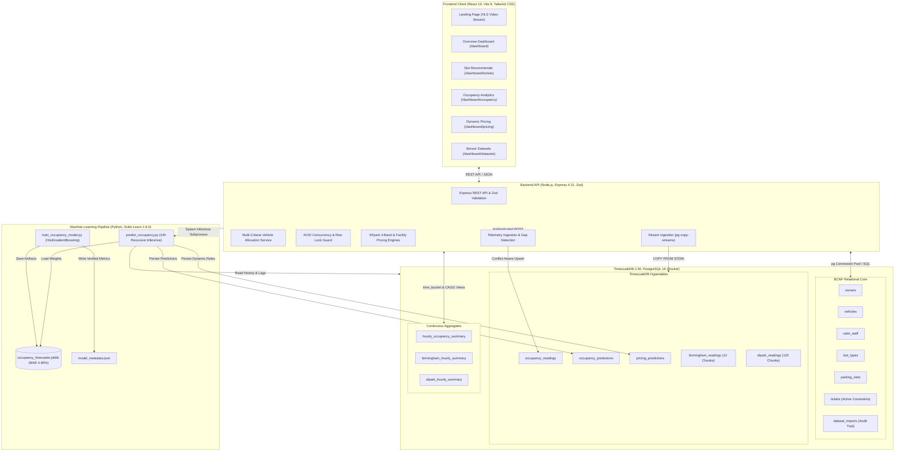

# ValetTrack

Intelligent parking orchestration, ACID slot allocation, and municipal time series analytics powered by TimescaleDB and Scikit-Learn.

<p align="center">
  
</p>

<p align="center">
  <a href="LICENSE"></a>
  <a href=".github/workflows/ci.yml"></a>
  <a href="https://nodejs.org/"></a>
  <a href="https://www.timescale.com/"></a>
  <a href="https://react.dev/"></a>
  <a href="https://scikit-learn.org/"></a>
  
</p>

---

## Table of Contents

- [Overview](#overview)
- [Key Features](#key-features)
- [Tech Stack](#tech-stack)
- [Architecture](#architecture)
- [Project Structure](#project-structure)
- [Getting Started](#getting-started)
  - [Prerequisites](#prerequisites)
  - [Installation](#installation)
  - [Environment Variables](#environment-variables)
  - [Running the Project](#running-the-project)
- [Usage](#usage)
- [API Reference](#api-reference)
- [Testing and Quality Assurance](#testing-and-quality-assurance)
- [Deployment](#deployment)
- [Roadmap](#roadmap)
- [Contributing](#contributing)
- [License](#license)
- [Acknowledgements](#acknowledgements)

---

## Overview

**ValetTrack** is an enterprise-grade parking management and time-series analytics platform designed to solve urban parking congestion, bay misallocation, and revenue leakage. It provides parking operators and valet staff with an end-to-end operational hub—from vehicle arrival and automated space recommendation to atomic slot locking and mathematically verified duration billing.

Underneath its dark-mode interface, ValetTrack combines a normalized Boyce-Codd Normal Form (BCNF) relational model in PostgreSQL with **TimescaleDB time-series hypertables** and pre-materialized continuous aggregates. This dual architecture guarantees strict ACID concurrency controls during peak parking rushes while processing millions of sensor observations at sub-100ms query latency.

Built for commercial parking facilities, municipal transit authorities, and urban researchers, ValetTrack incorporates a production-grade machine learning forecasting pipeline (`HistGradientBoostingRegressor`) and real-world municipal sensor benchmarks from the City of Birmingham (35.7K records) and San Francisco's SFpark sensor network (7,902,290 records). It directly bridges day-to-day valet logistics with empirical dynamic pricing and predictive capacity planning.

---

## Key Features

- **Boyce-Codd Normal Form (BCNF) Relational Core**: Schema design eliminates update anomalies and transitive dependencies across owners, vehicles, valet staff, slot types, physical spaces, and tickets.
- **Race-Condition-Free Slot Allocation**: Transactional row-level locking (`SELECT ... FOR UPDATE`) paired with partial unique indexes (`uq_active_slot_ticket`, `uq_active_vehicle_ticket`) prevents double booking and multiple active tickets for the same vehicle under concurrent load.
- **Automated Vehicle-to-Slot Recommendation Engine**: Evaluates incoming vehicles by powertrain (`EV`, `Hybrid`, `ICE`), vehicle dimensions, and clearance requirements to optimize space allocation (EVs to `EVCharging`, large vehicles to `Covered`, and sedans to `Regular`).
- **Mathematical Duration Billing**: Implements deterministic ceiling rounding (`CEIL(duration / 3600) * base_rate`), enforces a mandatory 1-hour minimum charge, and uses database triggers to automatically transition slot status between `Available` and `Occupied`.
- **High-Performance TimescaleDB Hypertables**: Automated time-partitioning across 5 hypertables (`occupancy_readings`, `occupancy_predictions`, `pricing_predictions`, `birmingham_readings`, and `sfpark_readings`).
- **Sub-100ms Continuous Aggregates**: Pre-materialized hourly summaries (`hourly_occupancy_summary`, `birmingham_hourly_summary`, and `sfpark_hourly_summary`) provide instant analytical query responses across 7.9M+ records.
- **Leakage-Free Machine Learning Forecaster**: Scikit-Learn `HistGradientBoostingRegressor` trained on 35,717 municipal sensor observations with causal lag construction (`lag_1h`, `lag_24h`), achieving a validation MAE of 4.85% (a 28.6% error reduction over naive persistence).
- **Dual Dynamic Pricing Models**: Supports both the municipal San Francisco SFpark 4-band dynamic meter policy (USD) and a facility 4-tier elasticity curve with surge and incentive tiers (INR ₹).
- **Authenticated Telemetry Ingestion API**: Secure endpoint (`POST /api/telemetry/readings`) protected by constant-time key validation (`crypto.timingSafeEqual`), past-only timestamp bounds, and stream health classifications (`HEALTHY`, `DEGRADED`, `STALE`, `UNAVAILABLE`).
- **Isolated Oracle 21c PL/SQL Reference Implementation**: Self-contained academic deliverable (`sql/oracle_valettrack.sql`) with Oracle DDL, sequences, billing functions, stored procedures, triggers, and the `pkg_valet_track` package.


---

## Tech Stack

| Category | Technology | Version | Purpose in ValetTrack |
|---|---|---|---|
| **Database** | TimescaleDB | 2.30.2 | Time-series hypertables, chunk management, and continuous aggregates |
| **Database Engine** | PostgreSQL | 16.15 | BCNF relational core, partial indexes, triggers, and ACID transactions |
| **Backend Runtime** | Node.js | 20.19+ / 22+ / 24 | Non-blocking I/O execution environment for REST API services |
| **Backend Framework** | Express.js | 4.21.2 | Modular REST API routing, error handling, and JSON serialization |
| **Input Validation** | Zod | 3.24.2 | Strict runtime schema validation for incoming payloads and parameters |
| **Database Client** | `node-postgres` (`pg`) | 8.13.3 | Connection pooling, transaction control, and parameterized queries |
| **Data Ingestion** | `pg-copy-streams` | 7.0.0 | High-speed binary streaming (`COPY ... FROM STDIN`) for sensor datasets |
| **Machine Learning** | Python | 3.10 – 3.12 | Execution environment for ML training and horizon forecasting pipelines |
| **ML Libraries** | Scikit-Learn | 1.9.0 | `HistGradientBoostingRegressor` model training, metrics, and persistence |
| **Data Processing** | Pandas & NumPy | >=2.2 / >=2.0 | Time-series chronological indexing, feature engineering, and lag alignment |
| **Frontend Framework** | React | 19.2.8 | Declarative single-page interface with concurrent rendering support |
| **Build Tool** | Vite | 8.3.0 | Modern ES module bundler and fast HMR development server |
| **Client Routing** | React Router | 7.18.4 | Client-side dashboard navigation and nested layout routing |
| **Styling** | Tailwind CSS | 3.4.17 | Utility-first design system with custom dark aesthetics |
| **Visualizations** | Recharts | 3.10.1 | Responsive SVG time-series charts, area graphs, and bar metrics |
| **Icons & Media** | Lucide React & Hls.js | 1.55 / 1.7 | Modern iconography and HTTP Live Streaming (HLS) landing video feed |
| **Testing** | Node.js Test Runner | Native (`node:test`) | Live database integration test suite (30 automated test suites) |
| **Linter** | Oxlint | 1.81.0 | High-performance Rust-based JavaScript and React linter |
| **Containerization** | Docker & Compose | Compose v2 | Multi-container definition and persistent volume orchestration |

---

## Architecture

ValetTrack separates operational transactional workflows from high-throughput analytical time-series pipelines:

1. **Client Layer**: React 19 single-page application communicating over HTTP REST with the backend API.
2. **Backend Services Layer**: Express.js router, validation middleware (Zod), allocation engine, dynamic pricing engine, and database pool manager.
3. **Relational Core (PostgreSQL 16)**: Boyce-Codd Normal Form schema storing customers, vehicles, staff, slots, and tickets with row locks (`FOR UPDATE`) for ACID allocation.
4. **Time-Series Engine (TimescaleDB 2.30)**: Five hypertables partitioned by timestamp, fed by continuous sensor feeds and historical benchmarks, rolled up via pre-materialized continuous aggregates.
5. **Machine Learning Pipeline**: Standalone Python pipeline using Scikit-Learn to train on municipal sensor observations and generate 24-hour horizon forecasts stored directly into PostgreSQL hypertables.



---

## Project Structure

```text
valettrack/
├── .env.example                 # Environment configuration template
├── .gitignore                   # Git exclusion rules (dependencies, secrets, builds, data)
├── compose.yaml                 # Docker Compose specification for TimescaleDB 2.30 container
├── LICENSE                      # MIT Open Source License
├── package.json                 # Root package manifest, orchestration scripts, and dependencies
├── package-lock.json            # Root dependency lockfile
├── requirements.txt             # Python machine learning dependencies (scikit-learn 1.9.0)
├── client/                      # Frontend Single Page Application (React 19 + Vite 8)
│   ├── .oxlintrc.json           # Oxlint static analysis configuration
│   ├── index.html               # SPA HTML entry point and web font configurations
│   ├── package.json             # Frontend dependencies (React Router 7, Recharts, Tailwind)
│   ├── postcss.config.js        # PostCSS configuration for Tailwind CSS
│   ├── tailwind.config.js       # Tailwind theme extensions, palettes, and animations
│   ├── vite.config.js           # Vite build pipeline and proxy configurations
│   ├── public/                  # Public static assets, brand marks, and favicons
│   │   ├── favicon.ico          # Fallback browser favicon
│   │   ├── favicon.png          # High-resolution primary PNG favicon
│   │   ├── valettrack-logo.png  # Full ValetTrack branding logo
│   │   └── valettrack-mark.png  # ValetTrack emblem mark used in dashboard navigation
│   └── src/                     # React source code
│       ├── App.jsx              # Main router definition and route hierarchy
│       ├── index.css            # Base Tailwind design system and CSS variable definitions
│       ├── main.jsx             # React DOM root bootstrapping
│       ├── components/          # Reusable UI components (Modal, StatusBadge)
│       ├── layouts/             # Shared layouts (DashboardLayout with navigation sidebar)
│       ├── pages/               # Application view controllers (Landing, Slots, Tickets, Analytics)
│       └── services/            # Axios/Fetch API client communicating with backend endpoints
├── data/                        # Static datasets and model serialization artifacts
│   ├── birmingham/
│   │   └── dataset.csv          # UCI Birmingham sensor dataset (35,717 records)
│   └── models/
│       ├── model_metadata.json  # Model card, evaluation metrics (MAE 4.85%), and features
│       └── occupancy_forecaster.joblib # Trained model weights (generated via npm run ml:train)
├── docs/                        # Project documentation and architectural media
│   └── assets/                  # Documentation branding logos and visual assets
├── scripts/                     # Automation, database lifecycle, and machine learning pipelines
│   ├── dev_reset.js             # Clean development database reset (guarded against production)
│   ├── import_birmingham.js     # Streaming ingestion for City of Birmingham parking sensors
│   ├── import_sfpark.js         # Binary COPY streaming importer for SFpark street sensors
│   ├── package_release.js       # Release packaging script with strict credential hygiene checks
│   ├── predict_occupancy.py     # Recursive multi-horizon ML inference script
│   ├── run_sql.js               # SQL runner executing files via Docker container or local psql
│   ├── seed.js                  # Safe, idempotent facility seed (preserves active tickets)
│   ├── seed_demo.js             # Realistic demo data seeder (owners, vehicles, staff, tickets)
│   └── train_occupancy_model.py # HistGradientBoosting ML model training pipeline
├── server/                      # Backend REST API Application (Node.js + Express)
│   ├── package.json             # Server dependencies (Express, pg, Zod, dotenv, cors)
│   └── src/
│       ├── app.js               # Express application initialization and middleware chain
│       ├── index.js             # Server entry point and HTTP listener
│       ├── config/              # Runtime configuration and production environment validation
│       ├── controllers/         # Request handlers for tickets, slots, analytics, and telemetry
│       ├── db/                  # PostgreSQL / TimescaleDB connection pool management
│       ├── middleware/          # Telemetry API key authentication, Zod validation, error handler
│       ├── routes/              # Modular Express routing definitions
│       ├── services/            # Vehicle allocation algorithms and dynamic pricing services
│       └── validation/          # Zod validation schemas for all incoming API payloads
├── sql/                         # Database DDL, seeding, verification, and academic SQL scripts
│   ├── analytics.sql            # Benchmark analytical queries utilizing time_bucket and CAGGs
│   ├── oracle_valettrack.sql    # Isolated Oracle 21c PL/SQL reference implementation
│   ├── schema.sql               # Primary PostgreSQL & TimescaleDB schema, hypertables, and views
│   ├── seed.sql                 # Baseline facility configuration SQL seed
│   └── verify.sql               # Automated SQL verification script testing schema invariants
└── tests/                       # Automated integration and regression test suite
    ├── backend.test.js          # 30 automated integration test suites executed with node:test
    └── mocks/
        └── mock_predict.py      # Python mock script for testing inference failure edge cases
```

---

## Getting Started

### Prerequisites

Ensure the following tools are installed on your workstation before starting:

- **Docker Desktop** (v24.0+ recommended) with Docker Compose enabled.
- **Node.js** (v20.19+, v22+ LTS, or v24) and **npm** (v10+).
- **Python** (v3.10, v3.11, or v3.12) with `pip`.
- **Git** (v2.30+).

---

### Installation

Clone the repository and install all project dependencies:

```bash
# 1. Clone the repository
git clone https://github.com/udarshcodes/valettrack.git
cd valettrack

# 2. Configure environment variables
# On Windows (PowerShell):
Copy-Item .env.example .env
# On Linux / macOS:
cp .env.example .env

# 3. Install root orchestration dependencies
npm install

# 4. Install backend server dependencies
npm install --prefix server

# 5. Install frontend client dependencies
npm install --prefix client

# 6. Install Python machine learning dependencies
pip install -r requirements.txt
```

> **Tip:** You can optionally isolate Python packages in a virtual environment (`python -m venv venv`, followed by `source venv/bin/activate` on Unix or `.\venv\Scripts\Activate.ps1` on Windows).

---

### Environment Variables

Configure your local environment parameters in `.env`. The project includes pre-configured development defaults in `.env.example`:

| Variable | Description | Default / Example Value | Required in Production? |
|---|---|---|---|
| `PORT` | HTTP port for the Express API server | `5000` | Optional (defaults to 5000) |
| `NODE_ENV` | Application environment (`development`, `production`, `test`) | `development` | Yes |
| `DB_HOST` | Hostname of the TimescaleDB / PostgreSQL instance | `localhost` | Yes |
| `DB_PORT` | Port exposed by TimescaleDB | `5432` | Yes |
| `DB_USER` | Database superuser / service account username | `valettrack` | Yes |
| `DB_PASSWORD` | Database user authentication secret | `valettrack_secret` | **Yes (disallows defaults)** |
| `DB_NAME` | Target database catalog name | `valettrack_db` | Yes |
| `CLIENT_ORIGIN` | Allowed CORS origin for the React client | `http://localhost:5174` | Yes |
| `TELEMETRY_API_KEY` | Secret key for authenticated sensor telemetry ingestion | `valettrack_telemetry_dev_key` | **Yes (min 16 chars, no defaults)** |

> [!IMPORTANT]
> When `NODE_ENV=production`, the application refuses to boot if `DB_PASSWORD` or `TELEMETRY_API_KEY` are left as placeholder values, or if `TELEMETRY_API_KEY` is fewer than 16 characters.

---

### Running the Project

#### 1. Development Mode

Execute the following commands in sequence:

```bash
# Step 1: Start the containerized TimescaleDB instance
npm run db:up

# Step 2: Initialize database schema, hypertables, continuous aggregates, and triggers
npm run db:init

# Step 3: Seed facility configuration (3 slot types and 24 parking spaces)
npm run db:seed

# Step 4: (Optional) Seed realistic demo owners, vehicles, staff, and active tickets
npm run seed:demo

# Step 5: Train the machine learning model on municipal sensor records
npm run ml:train

# Step 6: (Optional) Import municipal benchmark datasets
npm run import:birmingham        # 35.7K records from City of Birmingham
# npm run import:sfpark          # 7.9M records from SFpark (requires SFpark ZIP)
```

Now launch the application servers in two separate terminal windows:

```bash
# Terminal 1: Start Backend API (runs on http://localhost:5000)
npm run server

# Terminal 2: Start Frontend Client (runs on http://localhost:5174)
npm run client
```

- **Frontend Application**: [http://localhost:5174](http://localhost:5174)
- **Backend API Server**: [http://localhost:5000](http://localhost:5000)
- **API Health Check**: [http://localhost:5000/api/health](http://localhost:5000/api/health)

---

#### 2. Production Mode

```bash
# Step 1: Build the optimized static frontend bundle
npm run build:client

# Step 2: Preview the production bundle locally (or serve client/dist via Nginx/Caddy)
npm run preview --prefix client

# Step 3: Run the backend server in production mode
NODE_ENV=production npm run server
```

---

## Usage

### 1. Ingesting Real-Time Sensor Telemetry

Send facility sensor observations to the authenticated telemetry endpoint:

```bash
curl -X POST http://localhost:5000/api/telemetry/readings \
  -H "Content-Type: application/json" \
  -H "x-telemetry-key: valettrack_telemetry_dev_key" \
  -d '{
    "reading_time": "2026-10-17T15:00:00Z",
    "slot_type_id": 1,
    "total_slots": 12,
    "occupied_slots": 8,
    "source": "valet_gate_sensor"
  }'
```

**Response (HTTP 201 Created):**
```json
{
  "message": "Telemetry readings successfully ingested.",
  "ingested_count": 1,
  "duplicates_updated": 0,
  "slot_type_id": 1
}
```

---

### 2. Requesting Vehicle-to-Slot Recommendations

Obtain an optimal bay recommendation based on vehicle dimensions and powertrain:

```bash
curl -X POST http://localhost:5000/api/slots/recommend \
  -H "Content-Type: application/json" \
  -d '{
    "vehicle_no": "KA-01-EV-2026",
    "type": "Sedan",
    "powertrain": "EV"
  }'
```

**Response (HTTP 200 OK):**
```json
{
  "recommended_slot": {
    "slot_id": 21,
    "slot_type_id": 3,
    "type_name": "EVCharging",
    "base_rate": 120.00,
    "status": "Available"
  },
  "rationale": "Prioritized Level 2 EVCharging bay (Slot 21) based on vehicle electric powertrain specifications.",
  "match_score": 95
}
```

---

### 3. Atomically Opening a Parking Ticket

Allocate a bay and open an active ticket with ACID concurrency protection:

```bash
curl -X POST http://localhost:5000/api/tickets \
  -H "Content-Type: application/json" \
  -d '{
    "vehicle_no": "KA-01-EV-2026",
    "slot_id": 21,
    "staff_id": 1
  }'
```

**Response (HTTP 201 Created):**
```json
{
  "ticket_id": 72,
  "vehicle_no": "KA-01-EV-2026",
  "slot_id": 21,
  "staff_id": 1,
  "entry_time": "2026-10-17T15:05:00.000Z",
  "exit_time": null,
  "amount_paid": 0.00,
  "status": "active"
}
```

---

### 4. Closing a Ticket and Calculating Duration Billing

Close the ticket, release the slot, and compute the billable charge:

```bash
curl -X POST http://localhost:5000/api/tickets/72/close
```

**Response (HTTP 200 OK):**
```json
{
  "ticket_id": 72,
  "vehicle_no": "KA-01-EV-2026",
  "slot_id": 21,
  "entry_time": "2026-10-17T15:05:00.000Z",
  "exit_time": "2026-10-17T16:20:00.000Z",
  "billable_hours": 2,
  "base_rate": 120.00,
  "amount_paid": 240.00,
  "slot_status": "Available"
}
```

---

### 5. Generating 24-Hour Horizon ML Occupancy Forecasts

Trigger recursive autoregressive forecasting and persist results to the database:

```bash
curl -X POST "http://localhost:5000/api/predictions/generate?mode=historical_replay"
```

**Response (HTTP 201 Created):**
```json
{
  "status": "SUCCESS",
  "mode": "historical_replay",
  "predictions_count": 18,
  "generation_time": "2026-10-17T15:10:00.000Z",
  "model_version": "v1.4-gb-leakage-free-exact",
  "forecast_horizons": ["1h", "2h", "4h", "8h", "12h", "24h"]
}
```

---

## API Reference

The backend exposes a structured, modular REST API under `/api`:

### System Health & Status

| Method | Endpoint | Description | Auth Required |
|---|---|---|---|
| `GET` | `/api/health` | Inspects TimescaleDB version, connected hypertables, and continuous aggregate views | None |

### Dashboard & Analytics

| Method | Endpoint | Parameters / Query | Description |
|---|---|---|---|
| `GET` | `/api/dashboard/summary` | None | Live capacity counts, slot distribution, active tickets, and revenue |
| `GET` | `/api/analytics/daily` | `slot_type_id`, `start_date`, `end_date` | Continuous multi-day occupancy mathematically derived from tickets |
| `GET` | `/api/analytics/hourly` | `hours`, `slot_type_id` | Hourly time-weighted average, true peak, and minimum occupancy |
| `GET` | `/api/analytics/continuous-aggregate` | `limit` | Prematerialized continuous aggregate rollups from TimescaleDB |
| `GET` | `/api/analytics/facility-pricing-recommendations` | None | Facility dynamic rate suggestions across slot categories |

### Parking Space Allocation & Management

| Method | Endpoint | Payload / Query | Description |
|---|---|---|---|
| `GET` | `/api/slots` | None | List all physical spaces with status and category metadata |
| `POST` | `/api/slots` | `{ slot_type_id, status }` | Create a new parking space with synchronized sequence IDs |
| `GET` | `/api/slots/:id` | None | Retrieve slot details and historical ticket activity |
| `DELETE` | `/api/slots/:id` | None | Safely delete slot (rejected if historical tickets exist) |
| `POST` | `/api/slots/recommend` | `{ vehicle_no, type, powertrain }` | Recommend optimal space based on vehicle specifications |
| `PUT` | `/api/slots/:id/status` | `{ status }` | Update bay status (rejected if an active ticket is open) |

### Operational Tickets & Billing

| Method | Endpoint | Payload / Query | Description |
|---|---|---|---|
| `GET` | `/api/tickets` | `status` (`active`\|`completed`\|`all`), `limit`, `offset` | List operational parking tickets with vehicle and slot joins |
| `POST` | `/api/tickets` | `{ vehicle_no, slot_id, staff_id }` | Atomically lock slot and issue ticket (ACID concurrency guard) |
| `GET` | `/api/tickets/:id` | None | Retrieve ticket details, duration, and calculated charges |
| `POST` | `/api/tickets/:id/close`| None | Close ticket, compute stay duration, apply billing, and release bay |

### Customers, Vehicles & Valet Staff

| Method | Endpoint | Description |
|---|---|---|
| `GET` / `POST` | `/api/owners` | List registered vehicle owners or create a new owner profile |
| `GET` / `PUT` / `DELETE` | `/api/owners/:id` | View, update, or safely delete an owner profile |
| `GET` / `POST` | `/api/vehicles` | List registered vehicles or create a vehicle-owner association |
| `GET` / `PUT` / `DELETE` | `/api/vehicles/:plate` | View, update, or safely delete a vehicle record |
| `GET` / `POST` | `/api/staff` | List valet staff members or onboard a new attendant |
| `GET` / `PUT` / `DELETE` | `/api/staff/:id` | View, update, or safely delete a staff profile |

### Machine Learning & Dynamic Pricing

| Method | Endpoint | Description |
|---|---|---|
| `GET` | `/api/predictions/status` | Model metadata card, validation metrics (MAE 4.85%), and disk presence |
| `POST` | `/api/predictions/generate` | Trigger ML inference (`mode=historical_replay` or `mode=operational`) |
| `GET` | `/api/predictions/occupancy` | Return persisted 24-hour occupancy horizon forecasts |
| `GET` | `/api/predictions/pricing` | Return persisted dynamic pricing recommendations |
| `GET` | `/api/sfpark/pricing-recommendations`| SFpark 4-band dynamic meter policy adjustment calculation |

### Live Telemetry Ingestion

| Method | Endpoint | Headers | Description |
|---|---|---|---|
| `POST` | `/api/telemetry/readings` | `x-telemetry-key` or `Bearer <key>` | Authenticated sensor reading ingestion (single or array up to 500) |
| `GET` | `/api/telemetry/status` | None | Ingestion metrics, 48h counts, stream classification, and readiness |
| `GET` | `/api/telemetry/recent` | `limit`, `offset`, `slot_type_id` | Paginated historical sensor telemetry observations |

---

## Testing and Quality Assurance

ValetTrack includes an automated integration test suite that executes against live TimescaleDB instances:

```bash
# 1. Run complete automated integration test suite (30 test suites)
npm test

# 2. Run database invariants, schema constraints, and PL/pgSQL verification
npm run db:verify

# 3. Run frontend static analysis (Oxlint)
npm run lint

# 4. Verify release packaging hygiene and secret protection
npm run package
```

### Verified System Invariants

The 30 automated integration test suites (`tests/backend.test.js`) validate the following guarantees:

1. **TimescaleDB Connectivity & Hypertables**: Verifies PostgreSQL 16 + TimescaleDB 2.30 and hypertable registration.
2. **Dashboard Summary API**: Validates live capacity, slot states, and revenue aggregates.
3. **Owner CRUD & Schema Validation**: Verifies unique phone/email rules and deletion protections.
4. **Vehicle Registration**: Confirms foreign key relationships between owners and vehicles.
5. **Ticket Lifecycle & Billing**: Verifies duration calculation, minimum 1-hour charge, and double-close rejection.
6. **Concurrent Double-Allocation Protection**: Validates that simultaneous bookings targeting the same bay reject the losing transaction with HTTP 409 Conflict.
7. **Concurrent Duplicate Vehicle Protection**: Rejects attempts to open multiple active tickets for the same vehicle across different bays with HTTP 409 Conflict (`VehicleAlreadyParked`).
8. **Double Ticket Closure Rejection**: Asserts double-close attempts return HTTP 400 `AlreadyClosed`.
9. **Time-Weighted Occupancy Mathematics**: Validates exact fractional occupancy formulas over disjoint ticket intervals.
10. **Continuous Calendar Range Generation**: Confirms that zero-ticket dates return 0.0% occupancy without being omitted.
11. **Midnight Interval Splitting**: Verifies stay duration interval splitting across calendar day boundaries.
12. **Missing Observation Handling**: Asserts minimum occupancy correctly reaches 0.0% during unoccupied intervals.
13. **Chronological Series Sorting**: Ensures all analytical time-series endpoints return ascending chronological data.
14. **SFpark 4-Band Boundary Verification**: Validates pricing adjustments across 0%, 29.99%, 30%, 59.99%, 60%, 80%, 80.01%, and 100%.
15. **Facility Dynamic Pricing Verification**: Verifies 4-tier elasticity curve in ₹ INR (+20% surge, 0% baseline, -10% incentive, -20% discount).
16. **Primary Key Sequence Synchronization**: Confirms that inserting records after explicit seed IDs does not collide with primary key sequences.
17. **Safe Seed Invariant Preservation**: Confirms that running `npm run db:seed` preserves existing `Occupied` and `Reserved` statuses without resetting them to `Available`.
18. **Time-Series Lag Feature Exactness**: Validates that `lag_1h` strictly represents $t - 1\text{h}$ and `lag_24h` strictly represents $t - 24\text{h}$.
19. **Information Leakage Prevention**: Confirms chronological train/validation splitting occurred before preprocessing, and holdout evaluation was conducted exclusively on 148 genuine observed targets.
20. **ML Model Alignment & Recursive Inference**: Validates model file presence, Scikit-Learn 1.9.0 runtime compatibility, multi-horizon forecasts, and transaction safety.
21. **Operational vs Demonstration Mode Handling**: Asserts that operational forecasting without live telemetry returns `INSUFFICIENT_CURRENT_DATA` instead of fabricating fake data.
22. **Real-World Continuous Aggregates**: Queries both Birmingham (35.7K) and SFpark (7.9M) continuous aggregates.
23. **Dataset Import Audit Trail**: Confirms SHA256 checksums, processed row counts, and production overwrite safeguards in `dataset_imports`.
24. **Secret Protection & Packaging Hygiene**: Verifies that `.env`, binary `.joblib` files, `.git`, and archives are excluded from release archives.
25. **Telemetry Authentication & Validation**: Validates constant-time key checks, Bearer tokens, and input validation (rejecting future skews, malformed numbers, and capacity overflows).
26. **Telemetry Ingestion & Gap Detection**: Verifies 25-hour batch ingestion, conflict-aware upserts, 24-hour consecutive lag readiness, and gap detection.
27. **Referential Integrity Protection**: Asserts that deleting slots, staff, owners, or vehicles with active or historical ticket records is rejected with HTTP 400 `CannotDelete`.
28. **Inference Security & Injection Protection**: Validates argument sanitation, rejecting shell metacharacters and unsupported modes with HTTP 400.
29. **Hardened Prediction Fault Tolerance**: Guarantees rejection of malformed Python output, unsuccessful statuses, zero predictions, and stale cached predictions.
30. **Stream Health Classification**: Verifies transition between `HEALTHY`, `DEGRADED`, `STALE`, and `UNAVAILABLE` stream classifications based on sensor feed timeliness.

---

## Deployment

### 1. Database Tier (Containerized TimescaleDB)

The database tier is defined in [compose.yaml](compose.yaml) using the official `timescale/timescaledb:latest-pg16` image:

```bash
# Launch container with automatic restart and persistent volume
docker compose up -d

# Verify container health check
docker compose ps
```

The database volume `valettrack_pgdata` persists all tables, hypertables, and continuous aggregates across container restarts.

---

### 2. Backend API Tier (Node.js Service)

Run the backend API under a process manager such as PM2 or systemd:

```bash
# Build environment configuration
export NODE_ENV=production
export DB_HOST=your-production-db-host
export DB_PORT=5432
export DB_USER=valettrack
export DB_PASSWORD=your_strong_production_password
export DB_NAME=valettrack_db
export CLIENT_ORIGIN=https://valettrack.yourdomain.com
export TELEMETRY_API_KEY=your_strong_telemetry_key_min16chars

# Start backend service
node server/src/index.js
```

---

### 3. Frontend Client Tier (Static Asset Hosting)

Generate the production static assets:

```bash
npm run build:client
```

Deploy the contents of `client/dist/` to your web server (Nginx, Caddy, Cloudflare Pages, or AWS S3/CloudFront). Example Nginx configuration:

```nginx
server {
    listen 80;
    server_name valettrack.yourdomain.com;
    root /var/www/valettrack/client/dist;
    index index.html;

    location / {
        try_files $uri $uri/ /index.html;
    }

    location /api/ {
        proxy_pass http://127.0.0.1:5000/api/;
        proxy_http_version 1.1;
        proxy_set_header Host $host;
        proxy_set_header X-Real-IP $remote_addr;
        proxy_set_header X-Forwarded-For $proxy_add_x_forwarded_for;
    }
}
```

---

## Roadmap

The following architectural enhancements are planned based on existing codebase hooks:

- [ ] **Automated Continuous Aggregate Refresh Policies**: Implement native TimescaleDB background worker policies (`add_continuous_aggregate_policy`) for unattended incremental rollups.
- [ ] **Real-Time WebSocket / SSE Feed**: Replace polling with Server-Sent Events (SSE) or WebSockets to broadcast live slot occupancy shifts and ticket states to all connected operator terminals.
- [ ] **Mobile Valet Attendant PWA**: Build an offline-capable Progressive Web App with optical barcode and QR scanning for rapid vehicle check-in and check-out at facility entrances.
- [ ] **Multi-Facility Zoning & Tenancy**: Extend the schema with multi-facility foreign keys to manage multiple distributed garages and municipal parking districts from a single control pane.

---

## Contributing

Contributions to ValetTrack are welcome. Please adhere to the following workflow:

1. **Fork the Repository**: Create your personal fork on GitHub.
2. **Create a Feature Branch**:
   ```bash
   git checkout -b feature/my-feature-name
   ```
3. **Implement Changes**: Write clean, modular code consistent with existing patterns.
4. **Verify Tests & Linting**:
   ```bash
   npm test
   npm run db:verify
   npm run lint
   ```
5. **Commit Changes**: Use concise, conventional commit messages:
   ```bash
   git commit -m "feat(allocation): add proximity weighting to slot recommendation"
   ```
6. **Push and Open a Pull Request**: Push your branch to GitHub and submit a PR against `main`.

---

## License

This project is licensed under the **MIT License**. See the [LICENSE](LICENSE) file for details.

```text
MIT License
Copyright (c) 2026 Udarsh Goyal
```


---

## Acknowledgements

- **City of Birmingham Parking Sensor Dataset**: Sourced from the [UCI Machine Learning Repository](https://archive.ics.uci.edu/dataset/482/parking+birmingham) (Daniel H. Stolfi, Enrique Alba, 2016).
- **SFpark Pilot Street Sensor Dataset**: Sourced from the [San Francisco Municipal Transportation Agency (SFMTA)](https://www.sfmta.com/projects/sfpark) and the City and County of San Francisco.
- **TimescaleDB Team**: For high-performance time-series extensions, hypertables, and continuous aggregation primitives on PostgreSQL.
- **Scikit-Learn Community**: For robust machine learning estimators and time-series regressor implementations.