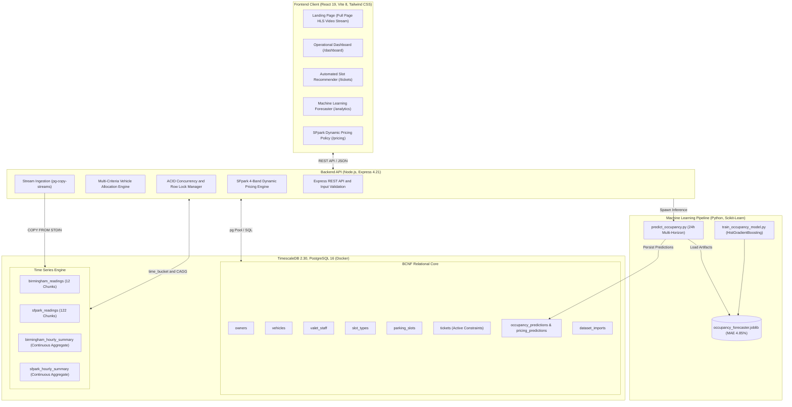

# ValetTrack: Intelligent Parking Orchestration and Time Series Analytics

<p align="center">
  
</p>

<p align="center">
  <a href="https://www.timescale.com/"></a>
  <a href="https://nodejs.org/"></a>
  <a href="https://react.dev/"></a>
  
  
  
</p>

> **ValetTrack** is an enterprise grade parking management and time series analytics platform. It unifies a high end dark aesthetic landing page with Boyce-Codd Normal Form (BCNF) relational models, **TimescaleDB time series hypertables**, prematerialized continuous aggregates, ACID slot allocation, a production machine learning time series forecaster, automated vehicle-to-space allocation, and real world municipal parking sensor benchmarks from the City of Birmingham (35.7K records) and the complete San Francisco SFpark dataset (**7,902,290 records**).

---

## 1. System Architecture and Key Capabilities



### A. Core Relational Operations and Concurrency Safety
* **Boyce-Codd Normal Form (BCNF)**: Normalized relational schema eliminating update anomalies and transitive dependencies across Owners, Vehicles, Valet Staff, Slot Types, Parking Slots, and Tickets.
* **Vehicle Concurrency Guard**: Partial unique index `uq_active_vehicle_ticket` on `tickets(vehicle_no) WHERE exit_time IS NULL` prevents any vehicle from holding multiple active parking tickets across the facility simultaneously.
* **Slot Double Booking Guard**: Partial unique index `uq_active_slot_ticket` on `tickets(slot_id) WHERE exit_time IS NULL` and transactional row locking (`SELECT ... FOR UPDATE`) guarantees race-condition-free slot occupancy under high concurrent load.
* **Safe Dynamic Sequence Synchronization**: Database routine `fn_sync_all_sequences()` dynamically aligns PostgreSQL `SERIAL` sequences with `MAX(id)` after explicit seed operations.
* **Deterministic Billing Rules**: Enforces exact mathematical stay duration rounding (`CEIL(duration / 3600) * BaseRate`), a mandatory 1-hour minimum charge, and base rates tied to slot categories.
* **Safe Seeding vs Dev Reset**: `npm run db:seed` performs safe, non-destructive upserts. Intentional cleanup is isolated to `npm run db:reset`, protected by strict safeguards that refuse to execute in production (`NODE_ENV=production`).

### B. Machine Learning Forecaster and Automated Slot Allocation
* **Production Time Series Forecaster**: Real `HistGradientBoostingRegressor` trained on 35,717 hourly municipal observations with complete continuous hourly indexing and strict leakage prevention (chronological split before preprocessing). Features: `hour`, `day_of_week`, `is_weekend`, `lag_1h`, `lag_24h`.
  * **Validation MAE:** **4.85%** | **RMSE:** **9.41%** | **$R^2$:** **0.6896** (evaluated strictly on 148 genuine observed holdout targets, achieving a 28.6% error reduction over the naive 24h persistence baseline of 6.79% MAE).
* **Automated Multi-Criteria Slot Allocation**: Evaluates incoming vehicles by powertrain and dimensions:
  * **Electric Vehicles (EV):** Prioritized for Level 2 `EVCharging` spaces.
  * **SUVs & Large Vehicles:** Prioritized for wide-clearance `Covered` spaces.
  * **Sedans & Hatchbacks:** Directed to standard `Regular` spaces to conserve premium bays.
  * Provides explainable allocation rationales via `/api/slots/recommendation` and interactive frontend.

### C. TimescaleDB Time Series Engine and Real Municipal Datasets
* **Hypertables**: Automated time based chunk partitioning on `birmingham_readings` (12 chunks) and `sfpark_readings` (122 chunks).
* **Continuous Aggregates**: Prematerialized hourly summaries via `birmingham_hourly_summary` and `sfpark_hourly_summary` providing sub-100ms analytical response times across 7.9M+ records.
* **Integrated Real Datasets**:
  * **City of Birmingham (UCI Machine Learning Repository)**: 35,717 real sensor observations across 30 car parks (Oct to Dec 2016) with negative sensor glitches clamped to 0.
  * **SFpark Street Sensor Dataset (City of San Francisco)**: **7,902,290 real observations** across 10 commercial districts (2011 to 2013). Streamed directly from repository ZIP archive via `COPY ... FROM STDIN`.
* **Empirical 4-Band Dynamic Pricing Policies**:
  * **SFpark Municipal Meter Policy ($ USD)**: Documented SFpark pilot dynamic pricing rules (>80% +$0.25, 60–80% maintain, 30–<60% -$0.25, <30% -$0.50, floor $0.25, ceiling $6.00).
  * **ValetTrack Facility Dynamic Pricing (₹ INR)**: 4-tier elasticity curve for facility bays (>80% +20% surge, 60–80% standard, 30–<60% -10% incentive, <30% -20% discount).

---

## 2. Technology Stack & Supported Runtimes

| Layer | Technologies | Details |
|---|---|---|
| **Database** | TimescaleDB on PostgreSQL | `2.30.2` (PG 16.15) with Docker Compose named volume persistence (`valettrack_pgdata`) |
| **Backend** | Node.js, Express.js | Express 4.21, `pg` connection pool, `pg-copy-streams`, Zod validation |
| **Machine Learning** | Python 3, Scikit-Learn | Scikit-Learn 1.9.0, Joblib, NumPy, Pandas (`HistGradientBoostingRegressor`) |
| **Frontend** | React 19, Vite 8 | Single page application with React Router 7, Tailwind CSS 3.4 |
| **Supported Node.js** | Node.js 20.19+, Node.js 22+ LTS | Required by Vite 8 & React 19 (Tested and validated on Node.js 24) |
| **Testing** | Node.js Test Runner | `node:test` and `node:assert` (**30 automated integration test suites**) |

---

## 3. Quickstart and Local Setup Instructions

### Prerequisites
* [Docker Desktop](https://www.docker.com/products/docker-desktop/) installed and **actively running** in the background.
* [Node.js](https://nodejs.org/) (v20.19+, v22+ LTS, or v24).
* [Python 3.10+](https://www.python.org/) with `pip`.

---

### 🚀 Daily Quick Start (If Already Set Up)
If you have already installed dependencies and initialized the database, you only need 3 steps to run the app:

```powershell
# 1. Start TimescaleDB container
npm run db:up

# 2. Start Backend API Server (Terminal 1)
npm run server

# 3. Start Frontend Client (Terminal 2)
npm run client
```
* **Frontend App:** [http://localhost:5174](http://localhost:5174)
* **Backend API:** [http://localhost:5000](http://localhost:5000) (Health check: [http://localhost:5000/api/health](http://localhost:5000/api/health))

---

### 👥 Teammate & Reviewer Guide: Can You Run by Just Forking?

> **Yes, absolutely!** This repository is **100% self-contained**. Any teammate, evaluator, or reviewer can fork or clone this repository and run the full stack (TimescaleDB, backend API, React 19 UI, machine learning pipeline, and all 30 tests) without needing any private databases, proprietary files, or external assets sent separately.

#### Why a Fresh Fork Works Out-of-the-Box:
1. **Containerized Database**: [compose.yaml](file:///c:/Users/Udarsh/valettrack/compose.yaml) pulls the public `timescale/timescaledb:latest-pg16` image automatically. No local PostgreSQL installation is required.
2. **Relational Core & Seed**: [sql/schema.sql](file:///c:/Users/Udarsh/valettrack/sql/schema.sql), [sql/seed.sql](file:///c:/Users/Udarsh/valettrack/sql/seed.sql), and [scripts/seed_demo.js](file:///c:/Users/Udarsh/valettrack/scripts/seed_demo.js) initialize the Boyce-Codd Normal Form schema, TimescaleDB hypertables, continuous aggregates, sequences, and realistic demo data with a single command.
3. **Machine Learning Pipeline**: The municipal training dataset ([data/birmingham/dataset.csv](file:///c:/Users/Udarsh/valettrack/data/birmingham/dataset.csv), 35.7K rows) is tracked in Git. Running `npm run ml:train` builds the `HistGradientBoosting` model and writes `occupancy_forecaster.joblib` locally.
4. **Media & Assets**: Video streaming on the landing page is hosted via public HTTPS CDN (Mux HLS), and all UI logos/icons are committed in [client/public/](file:///c:/Users/Udarsh/valettrack/client/public/).
5. **Self-Healing Test Suite**: [tests/backend.test.js](file:///c:/Users/Udarsh/valettrack/tests/backend.test.js) automatically bootstraps baseline demo data, Birmingham data, and continuous aggregate fixtures if tables are empty. All 30 test suites pass out-of-the-box on a fresh clone.
6. **Continuous Integration Proven**: GitHub Actions CI ([.github/workflows/ci.yml](file:///c:/Users/Udarsh/valettrack/.github/workflows/ci.yml)) tests this exact fresh-clone lifecycle on clean Ubuntu runners on every push.

#### Note on Gitignored Files:
* `.env`: Kept out of Git for security hygiene. Simply copy [.env.example](file:///c:/Users/Udarsh/valettrack/.env.example) to `.env`.
* `*.joblib`: Binary model weights are generated on-demand via `npm run ml:train`.
* `SFpark...zip` (246 MB): Gitignored to keep the repository under GitHub limits. The application and test suite **do not require this file** to run. (The full 7.9M streaming import `npm run import:sfpark` is an optional benchmark).

---

### 🛠️ Complete First-Time Setup (From Scratch)

#### Step 1: Environment Configuration & Dependencies
Create your local `.env` file from the provided template and install all dependencies:

**PowerShell (Windows):**
```powershell
Copy-Item .env.example .env
```
**Bash / macOS / Linux:**
```bash
cp .env.example .env
```

Now install root, backend, frontend, and Python ML dependencies:
```powershell
# Root dependencies (pg, pg-copy-streams, csv-parser)
npm install

# Backend server dependencies (Express, Zod, CORS)
npm install --prefix server

# Frontend client dependencies (React 19, Vite 8, Tailwind CSS)
npm install --prefix client

# Python Machine Learning dependencies (Scikit-Learn, Pandas, NumPy, Joblib)
pip install -r requirements.txt
```
> *Tip: For Python, you can optionally create and activate a virtual environment first (`python -m venv venv`, then `.\venv\Scripts\Activate.ps1` on Windows or `source venv/bin/activate` on Linux/macOS).*

#### Step 2: Start Local TimescaleDB Container
Ensure Docker Desktop is open and the engine is running, then start the container:
```powershell
npm run db:up
```
*Container `valettrack-timescaledb` starts on port `5432` with persistent volume `valettrack_pgdata`.*
Check container status anytime using `docker compose ps`.

#### Step 3: Apply Database Schema & Facility Seeding
```powershell
# 1. Apply relational schema, hypertables, continuous aggregates, triggers, and constraints
npm run db:init

# 2. Safely initialize facility configuration (3 slot types & 24 physical spaces)
# Note: Idempotent and safe. Preserves existing operational tickets and customer records.
npm run db:seed

# 3. (Optional) Populate realistic demo owners, vehicles, valet staff, and sample tickets
npm run seed:demo
```
*(Note on Development Reset: To perform an intentional, clean reset during local development, run `npm run db:reset`. This command contains strict safeguards that refuse to execute in production).*

#### Step 4: Train ML Forecaster & Generate Horizon Predictions
```powershell
# 1. Train the HistGradientBoosting occupancy model on 35.7K municipal observations
npm run ml:train

# 2. Generate 24-hour horizon forecasts across facility slot types and persist to PostgreSQL
npm run ml:predict
```

#### Step 5: (Optional) Ingest Municipal Real-World Sensor Datasets
To populate continuous aggregates with benchmark sensor observations:
```powershell
# Import City of Birmingham sensor dataset (35,717 records)
npm run import:birmingham

# Import San Francisco SFpark street sensor dataset (7,902,290 records streamed via COPY)
npm run import:sfpark
```

#### Step 6: Start Application Servers
Open **two separate terminal windows** at the root of the project:

**Terminal 1 (Backend API):**
```powershell
npm run server
```
*Backend runs on `http://localhost:5000` (Health Check: `http://localhost:5000/api/health`).*
*For hot-reload during development, you can use: `npm run dev --prefix server`.*

**Terminal 2 (Frontend Client):**
```powershell
npm run client
```
*Frontend runs on `http://localhost:5174` with Vite HMR.*

---

### 🧪 Verification, Testing & Packaging Commands

```powershell
# 1. Run complete automated backend integration test suite (30/30 suites passing)
npm test

# 2. Run SQL database constraint, billing calculation, and hypertable verification
npm run db:verify

# 3. Build frontend production bundle with Vite
npm run build:client

# 4. Generate verified, secret-free release distribution package
npm run package
```

---

### 🛑 Stopping & Maintenance Commands

| Action | Command | Details |
|---|---|---|
| **Stop Database** | `npm run db:down` | Stops the TimescaleDB Docker container safely |
| **Development Reset** | `npm run db:reset` | Truncates tables, re-applies schema and seeds (dev mode only) |
| **Check Container Status** | `docker compose ps` | Inspects container health and port bindings |

---

### 🌐 Ports & Services Summary

| Service | Port | Local URL / Host | Default Credentials / Info |
|---|---|---|---|
| **Frontend UI** | `5174` | `http://localhost:5174` | Vite + React 19 Client |
| **Backend REST API** | `5000` | `http://localhost:5000` | Express API (`/api/health`, `/api/tickets`, etc.) |
| **TimescaleDB / Postgres** | `5432` | `localhost:5432` | `User: valettrack`, `DB: valettrack_db`, `Password: valettrack_secret` |

---

### 💡 Troubleshooting Common Issues

* **Docker engine not running**: If `npm run db:up` fails with `failed to connect to the docker API at npipe://...` or `cannot connect to Docker daemon`, open **Docker Desktop** from your applications menu and wait until the Docker engine status is green / running.
* **Port 5432 already allocated**: If you have a local PostgreSQL server already using port 5432, you can change `DB_PORT=5433` in `.env` and `compose.yaml` port binding will automatically map it to the container's 5432.
* **Python packages missing**: If `npm run ml:train` fails with missing modules, ensure you have run `pip install -r requirements.txt` in your active Python environment.

---

## 4. REST API Reference

### System Health & Status
* `GET /api/health`: Returns cluster status, database connection state, and hypertable metrics.

### Facility Dashboard & Analytics
* `GET /api/dashboard/summary`: Returns live capacity counts, slot distribution, and revenue summary.
* `GET /api/analytics/daily`: Mathematically derived daily occupancy from stay duration intervals.
* `GET /api/analytics/hourly`: Hourly average, peak, and minimum occupancy in latest chronological order.
* `GET /api/analytics/continuous-aggregate`: Prematerialized TimescaleDB continuous aggregate rollups.

### Machine Learning & Dynamic Pricing
* `GET /api/predictions/status`: Returns trained ML model card, validation MAE/RMSE, and active status.
* `POST /api/predictions/generate`: Triggers model inference to compute fresh 24h forecasts and store in DB (`mode=historical_replay` or `mode=operational`).
* `GET /api/predictions/occupancy`: Returns persisted in-database occupancy horizon forecasts.
* `GET /api/predictions/pricing`: Returns facility dynamic pricing recommendations derived from forecasts.
* `GET /api/sfpark/pricing-recommendations`: SFpark 4-band dynamic pricing adjustment engine.

### Operational Telemetry Ingestion (Live Sensors)
* `POST /api/telemetry/readings`: Authenticated ingestion endpoint for genuine facility occupancy observations. Requires `x-telemetry-key` header or `Bearer` token (configured via `TELEMETRY_API_KEY`). Protected by constant-time secret comparison (`crypto.timingSafeEqual`) and requires strong non-placeholder keys in production (min 16 characters). Validates timestamp, slot category, capacity, occupied spaces, non-numeric strings, and mathematical consistency. Supports single objects or JSON arrays up to 500 records. Enforces database-level uniqueness via `idx_occupancy_readings_unique` on `(reading_time, slot_type_id)` with conflict-aware upsert.
* `GET /api/telemetry/status`: Returns telemetry statistics, 48h reading counts, consecutive hourly stream length, staleness indicators (> 3h threshold), detected gap timestamps, and operational forecasting readiness (`ready_for_operational_forecast: true/false`, requiring 24 consecutive hourly observations for exact `lag_24h` feature calculation).
* `GET /api/telemetry/recent`: Returns recent ingested facility readings with validated pagination (`limit`, `offset`, optional `slot_type_id`).

### Parking Space Allocation & Management
* `GET /api/slots`: List physical parking spaces with current occupancy status.
* `POST /api/slots`: Create parking slot with synchronized identifier generation.
* `GET /api/slots/:id`: View slot details and historical ticket records.
* `DELETE /api/slots/:id`: Safely delete unreferenced parking slot (protected by referential integrity check returning HTTP 400 `CannotDelete` if historical tickets exist).
* `GET /api/slots/recommendation`: Recommends optimal space based on vehicle powertrain and dimensions.
* `POST /api/slots/recommend`: POST endpoint for vehicle-to-slot recommendation matching.
* `PUT /api/slots/:id/status`: Update slot status (`Available`, `Occupied`, `Reserved`). Protected against manual changes while an active ticket is open.

### Operational Tickets and Billing Lifecycle
* `GET /api/tickets`: List operational tickets (`status=active` or `status=completed`).
* `POST /api/tickets`: Atomically allocate slot and open ticket (`{ vehicle_no, slot_id, staff_id }`). Protected by row level locking and partial unique indexes.
* `POST /api/tickets/:id/close`: Close ticket, calculate stay amount (`CEIL` hours * base rate), stamp exit timestamp, and release slot to Available. Double closure is rejected with HTTP 400 `AlreadyClosed`.

---

## 5. Automated Test Suite (30 Passing Test Suites)

The integration test suite (`tests/backend.test.js`) executes against the live database and validates all system invariants:

1. **Fresh Database Initialization & TimescaleDB Connectivity**: Confirms PostgreSQL 16 + TimescaleDB 2.30 and verifies registered hypertables.
2. **Dashboard Summary API**: Validates live metrics, slot counts, and capacity calculations.
3. **Owner CRUD & Input Validation**: Tests creation, validation errors, update, and clean deletion.
4. **Vehicle Registration**: Enforces valid foreign key references to owners.
5. **Ticket Lifecycle & Availability Check**: Validates slot locking, duplicate booking rejection (HTTP 409), duplicate active vehicle ticket rejection (HTTP 409), duration billing calculation, 1-hour minimum charge, and double close rejection.
6. **Concurrent Slot Allocation Protection (Different Vehicles, Same Slot)**: Launches simultaneous concurrent allocation requests on the exact same slot; asserts that exactly one succeeds (201) and the competing request is rejected (409 Conflict).
7. **Concurrent Duplicate Vehicle Requests (Same Vehicle, Different Slots)**: Asserts that two concurrent booking requests for the same vehicle targeting different parking slots reject the duplicate with HTTP 409 Conflict (`VehicleAlreadyParked`).
8. **Ticket Reopening & Duplicate Ticket Closure Rejection**: Asserts double-close attempts return HTTP 400 `AlreadyClosed`.
9. **Exact Hourly Occupancy Math & Deterministic Fixtures**: Validates mathematically derived hourly metrics on known fixtures (e.g. 4 slots with 15m + 30m non-overlapping tickets yields exact 18.75% avg, 25.0% peak, 0.0% min).
10. **Exact Daily Occupancy Values & Zero-Ticket Date Preservation**: Validates continuous multi-day calendar range generation where empty dates return 0.0% occupancy without being omitted.
11. **Multi-Day Ticket Spanning Midnight Interval Splitting**: Validates exact stay duration splitting across midnight into distinct calendar days using the complete facility capacity denominator (`total_slots * 24.0`).
12. **Missing Hourly Observations & Disjoint Interval Handling**: Validates empty-hour handling, true minimum occupancy reaching 0.0% during unoccupied gaps, and true peak occupancy.
13. **Correct Recent Time Window Selection & Chronological Order**: Validates ascending chronological ordering of analytical series.
14. **SFpark 4-Band Dynamic Pricing Boundary Tests**: Validates exact pricing adjustments across 0%, 29.99%, 30%, 59.99%, 60%, 80%, 80.01%, 100%, and the $0.25 minimum rate floor.
15. **Facility Dynamic Pricing Policy Verification**: Validates 4-tier elasticity curve in ₹ INR (+20% surge, 0% standard, -10% incentive, -20% off-peak) and rejects invalid inputs.
16. **Identifier Sequence Synchronization & Additional Slot Creation**: Validates that inserting records after explicit seed IDs does not cause primary key conflicts.
17. **Safe SQL & JavaScript Seeding Preservation**: Validates that executing both `scripts/seed.js` and `sql/seed.sql` against a database with active tickets and reserved bays preserves both `Occupied` and `Reserved` statuses without resetting them to `Available`.
18. **Time Series Lag Feature Exact Timestamp Alignment**: Verifies that `lag_1h` is strictly $t - 1\text{h}$ and `lag_24h` is strictly $t - 24\text{h}$.
19. **Prevention of Future Information Leakage During Model Validation**: Verifies chronological train/test split occurred before preprocessing, and holdout evaluation was conducted exclusively on 148 genuine observed targets.
20. **Machine Learning Model Artifacts, Scikit-Learn Alignment & Live Inference**: Validates model persistence, Scikit-Learn 1.9.0 runtime alignment, multi-horizon forecast generation (+1h, +2h, +4h, etc.), and in-database storage with transaction rollback safety.
21. **Operational Forecasting vs Historical Demonstration Mode Handling**: Asserts that operational forecasting without live telemetry returns `INSUFFICIENT_CURRENT_DATA` instead of fabricating observations.
22. **Real World Hypertable Continuous Aggregates**: Executes analytical queries on both Birmingham (35.7K) and SFpark (7.9M) continuous aggregates.
23. **Dataset Import Manifest Audit Log & Overwrite Safeguards**: Confirms audit log entries with verified SHA256 checksums, exact row counts, and production overwrite safeguards.
24. **Secret Protection, Distribution Package Hygiene & Release Packaging**: Verifies `.env` is excluded by git, release packaging script creates a clean distribution zip excluding all secrets and temporary assets, and asserts that production mode rejects missing/default DB passwords and telemetry keys.
25. **Telemetry API Authentication & Validation Guards**: Validates missing or invalid API keys return HTTP 401 Unauthorized (`InvalidTelemetryKey`), Bearer tokens are accepted, invalid payloads (future timestamps, capacity overflow, count inconsistency, malformed number strings like '20abc', primitive values, negative pagination limits) return HTTP 400 `ValidationError`.
26. **Telemetry Ingestion, Status Metrics & Operational Forecast Trigger**: Verifies 25-hour batch ingestion, database-level ON CONFLICT update deduplication, 24-hour consecutive lag readiness, gap detection revoking operational readiness, and refusal to impute synthetic data.
27. **Slot, Valet Staff, Owner & Vehicle Referential Integrity Protection**: Verifies creation and deletion of unused slots, while asserting that deleting slots, valet staff, registered vehicle owners, or vehicles with operational ticket records is rejected with HTTP 400 `CannotDelete`.
28. **Machine Learning Model Artifact Availability Guard & Injection Protection**: Verifies that the model status endpoint validates the physical presence of `occupancy_forecaster.joblib` artifact on disk rather than solely inspecting metadata, and asserts that prediction inference securely invokes child processes with array arguments (`execFile`), rejecting shell injection metacharacters and unsupported modes with HTTP 400 `InvalidPredictionMode`.
29. **Hardened Prediction Inference: Malformed Output, Unsuccessful Status & Stale Prediction Rejection**: Asserts that inference output is strictly validated against malformed non-JSON output, invalid schemas, unsuccessful statuses, zero prediction counts, and Python execution crashes. Guarantees that stale predictions from previous runs are rejected if fresh records cannot be retrieved from the database.
30. **Telemetry Readiness Edge Cases, Stream Classification & Feed Interruption Recovery**: Asserts that telemetry ingestion enforces past-only timestamps (rejecting future skews), max age limits (rejecting excessively stale observations > 7 days), mathematical consistency between counts and percentages, and capacity bounds. Verifies that `stream_health` accurately reflects `HEALTHY`, `DEGRADED`, `STALE`, and `UNAVAILABLE` states.

Run the test suite at any time:
```powershell
npm test
```

---

## 6. Oracle PL/SQL Academic Deliverable (`sql/oracle_valettrack.sql`)

An isolated Oracle 21c PL/SQL implementation is provided for academic evaluation, containing:
* BCNF Relational Schema (`OWNER_`, `Vehicle`, `ValetStaff`, `SlotType`, `ParkingSlot`, `Ticket`, `PricingPrediction`, `OccupancyPrediction`)
* Primary key sequences (`seq_owner`, `seq_staff`, `seq_slot`, etc.)
* Duration billing function (`fn_calculate_amount`) with 1-hour minimum charge
* Stored procedures (`proc_open_ticket`, `proc_close_ticket`, `proc_log_occupancy_prediction`, `proc_log_pricing_prediction`)
* Business rule triggers (`trg_ticket_before_insert`, `trg_ticket_after_insert`, `trg_ticket_after_update`)
* Package interface (`pkg_valet_track` specification and body)
* Complete demonstration block with error handling (`ORA-20002` double-close rejection)

> [!NOTE]
> **Oracle Execution Verification Status**:
> The script was executed and verified against a live **Oracle Database 21c Express Edition (Release 21.3.0.0.0)** instance running pluggable database `XEPDB1`. All DDL, DML, triggers, packages, demonstration routines, and queries completed successfully with exit code 0. In CI, GitHub Actions isolates this deliverable without introducing an Oracle container dependency into the TimescaleDB runner.

---

## 6. Academic Deliverables & Platform Architecture Separation

* **Academic Deliverable 1 (ER/EER & Relational Model)**: Documented in `docs/assessment_report.md` and `ValetTrack_DA_Report.pdf`. Covers entity-relationship modeling in Chen notation, total/partial participation constraints, and BCNF normalization removing transitive dependencies.
* **Academic Deliverable 2 (Oracle PL/SQL Implementation)**: Documented in `Da2.pdf` and preserved in [`sql/oracle_valettrack.sql`](file:///sql/oracle_valettrack.sql). Features Oracle DDL, sequences, sample data, `fn_calculate_amount`, ticket procedures (`proc_open_ticket`, `proc_close_ticket`), prediction logging procedures, triggers (`trg_ticket_before_insert`, `trg_ticket_after_insert`, `trg_ticket_after_update`), the `pkg_valet_track` package, and an automated demonstration block.
* **Application Deliverable (PostgreSQL & TimescaleDB System)**: The full-stack production software in this repository. Demonstrates high-performance time-series hypertables (5 hypertables), continuous aggregates (3 views), ACID concurrency controls, authenticated REST API, React 19 frontend with real-time analytics, and scikit-learn machine learning forecaster.