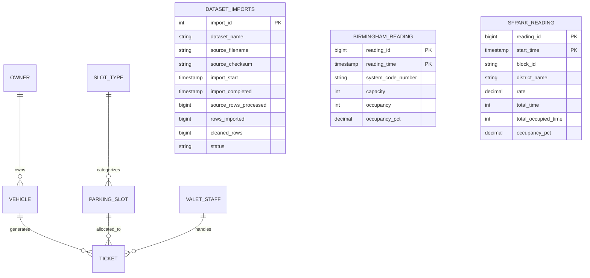

# ValetTrack: Modern Relational Core & Time Series Parking Management System
## DBMS Assessment Technical Report

---

### Executive Summary

**Project Title**: ValetTrack: Dynamic Parking Slot Allocation & Billing with TimescaleDB  
**Author / Candidate**: Udarsh  
**Academic Context**: DBMS Digital Assignment (DA2) Implementation & Real World Dataset Repair  
**Technology Stack**: TimescaleDB 2.30.2 (PostgreSQL 16.15), Node.js / Express.js, React 19, Vite 8, Tailwind CSS 3.4  
**Containerization**: Docker Desktop with Docker Compose (`compose.yaml`) and named volume persistence (`valettrack_pgdata`)  
**Integrated Municipal Datasets**: 
- **City of Birmingham (UCI ML Repository)**: 35,717 real observations across 30 car parks (Oct to Dec 2016).
- **SFpark Street Sensor Dataset (City of San Francisco)**: **7,902,290 real observations** across 10 commercial districts (Apr 2011 to Jul 2013).

---

## 1. Description of the Original ValetTrack System

The original ValetTrack system design, documented in `ValetTrack_DA_Report (2).pdf` and implemented in Oracle PL/SQL in `Da2(20261011 081756).PDF`, modeled a valet parking facility handling dynamic slot allocations, ticket opening/closure, and stay-duration billing.

### 1.1 Original Relational Entities & Attributes
- **Owner**: `OwnerID` (PK), `Name`, `Phone` (UNIQUE), `Email` (UNIQUE)
- **Vehicle**: `VehicleNo` (PK), `Type`, `Color`, `OwnerID` (FK $\to$ `Owner`)
- **ValetStaff**: `StaffID` (PK), `Name`, `Phone`, `ShiftTiming`
- **SlotType**: `SlotTypeID` (PK), `TypeName` (`'Regular'`, `'Covered'`, `'EVCharging'`), `BaseRate` ($\ge 0$)
- **ParkingSlot**: `SlotID` (PK), `SlotTypeID` (FK $\to$ `SlotType`), `Status` (`'Available'`, `'Occupied'`, `'Reserved'`)
- **Ticket**: `TicketID` (PK), `VehicleNo` (FK), `SlotID` (FK), `StaffID` (FK), `EntryTime`, `ExitTime`, `AmountPaid` ($\ge 0$)

### 1.2 Normalization to BCNF (Boyce-Codd Normal Form)
In an un-normalized schema, storing `BaseRate` directly on each `ParkingSlot` entity creates:
$$\text{ParkingSlot}(\underline{\text{SlotID}}, \text{SlotTypeID}, \text{Status}, \text{BaseRate})$$
A transitive functional dependency arises: $\text{SlotID} \to \text{SlotTypeID} \to \text{BaseRate}$. Because $\text{SlotTypeID}$ is not a superkey of `ParkingSlot`, this violates both 3NF and BCNF, leading to update anomalies whenever a category's base rate changes. Decomposing into:
1. $\text{ParkingSlot}(\underline{\text{SlotID}}, \text{SlotTypeID}, \text{Status})$
2. $\text{SlotType}(\underline{\text{SlotTypeID}}, \text{TypeName}, \text{BaseRate})$
guarantees that for every non-trivial functional dependency $X \to Y$, $X$ is a superkey, satisfying **BCNF**.

### 1.3 Business Logic, Integrity Triggers & Billing Rules
1. **Slot Availability Check**: A ticket can only be allocated if `Status = 'Available'` (enforced by trigger `trg_fn_ticket_before_insert`).
2. **Atomic Status Transition**: Inserting an active ticket transitions the slot to `'Occupied'`. Closing the ticket updates the slot status back to `'Available'`.
3. **Billing Computation Function (`fn_calculate_amount`)**:
   $$\text{Billable Hours} = \max\left(1, \lceil (\text{ExitTime} - \text{EntryTime}) \text{ in hours} \rceil\right)$$
   $$\text{Total Amount} = \text{Billable Hours} \times \text{SlotType.BaseRate}$$
4. **Clean Operational Setup**: The standard application startup contains zero synthetic customer records, fake vehicles, or mock predictions. True operational forms allow creating owners, vehicles, staff, slots, and tickets during interactive evaluation.

---

## 2. Selection of TimescaleDB as Modern Technology

### 2.1 The Time Series Nature of Parking Operations
Modern municipal and commercial parking operations are fundamentally time series workloads:
- Continuous inductive street sensor telemetry (hourly observation intervals).
- Periodic car park occupancy logs (15-minute intervals across municipal lots).
- Dynamic pricing elasticity monitoring (evaluating occupancy against target availability bands).

In conventional relational databases (e.g. monolithic Oracle tables without expensive Enterprise Partitioning licenses), querying high-frequency sensor readings over multi-year windows degrades rapidly as B-Trees exceed memory buffer pools.

### 2.2 Advantages of TimescaleDB
1. **Automatic Hypertable Chunking**: Tables appear as single PostgreSQL tables, while TimescaleDB automatically partitions rows into distinct time chunks (e.g., 7-day or 30-day partitions).
2. **$O(1)$ Ingestion Throughput**: Recent chunk indexes fit inside RAM buffer pools, eliminating degradation during bulk imports (achieving over 26,000 rows/second during full SFpark ingestion).
3. **Native Analytical Primitives (`time_bucket`)**: Simple interval grouping (e.g., `time_bucket('1 hour', bucket)`) replacing slow date arithmetic.
4. **Continuous Aggregates**: Automatically maintained, incrementally materialized rollups that update in the background, serving analytical dashboard queries in milliseconds.
5. **Full Relational Integrity**: Full ACID compatibility, transactional foreign keys, row level locking, and triggers alongside time series hypertables.

### 2.3 Limitations & Design Accommodations
- **Hypertable Composite Primary Keys**: Hypertables require the partitioning time column to be part of any unique index or primary key (`PRIMARY KEY (reading_id, reading_time)`).
- **Foreign Key Boundaries**: Hypertables can reference standard relational tables, but standard relational tables cannot reference hypertables.

---

## 3. Database Schema & Architecture



### 3.1 Relational Tables (BCNF Core)
- `owners (owner_id PK, name, phone UNIQUE, email UNIQUE, created_at)`
- `vehicles (vehicle_no PK, type, color, owner_id FK, created_at)`
- `valet_staff (staff_id PK, name, phone, shift_timing, created_at)`
- `slot_types (slot_type_id PK, type_name UNIQUE, base_rate CHECK >= 0)`
- `parking_slots (slot_id PK, slot_type_id FK, status CHECK IN ('Available','Occupied','Reserved'))`
- `tickets (ticket_id PK, vehicle_no FK, slot_id FK, staff_id FK, entry_time, exit_time, amount_paid)`
- `dataset_imports (import_id PK, dataset_name, source_filename, source_checksum, import_start, import_completed, source_rows_processed, rows_imported, cleaned_rows, status)`

### 3.2 Time Series Hypertables
- `birmingham_readings`: 35,717 records partitioned across 12 chunks on `reading_time`.
- `sfpark_readings`: 7,902,290 records partitioned across 122 chunks on `start_time`.

### 3.3 Continuous Aggregate Views
- `birmingham_hourly_summary`: Pre-materialized 1-hour rollups across 30 municipal car parks.
- `sfpark_hourly_summary`: Pre-materialized 1-hour rollups across 10 commercial districts with average meter rates.

---

## 4. Real Municipal Datasets & Import Engineering

### 4.1 Birmingham Parking Dataset (UCI Machine Learning Repository)
- **Source File**: `parking+birmingham.zip` (`dataset.csv`)
- **Checksum (SHA256)**: `af7d1b1b5bb85aa6cbf0e5212d06e76470a7fbe6c42c86ea01bf4c36d3a56ad8`
- **Source Rows**: `35,717` data rows (plus 1 header)
- **Imported Rows**: `35,717` (100% complete)
- **Glitches Clamped**: 12 records with negative sensor readings clamped to 0
- **Continuous Aggregate Rollups**: 18,955 pre-computed hourly summaries

### 4.2 SFpark Street Sensor Dataset (City of San Francisco)
- **Source File**: `SFpark_ParkingSensorData_HourlyOccupancy_20112013.zip` (~247 MB compressed, 1.49 GB uncompressed)
- **Checksum (SHA256)**: `3a6cc561b2d3d5006135e47a34a513b029d49b75d09e1fd30cd96184d28175f5`
- **Source Rows Processed**: `7,902,291`
- **Rows Imported in Database**: `7,902,290` (1 trailing malformed row rejected)
- **Streaming Pipeline**: `tar` extraction streamed directly to `csv-parser` and bulk-loaded via `COPY sfpark_staging FROM STDIN WITH (FORMAT text)`
- **Derived Measurements**: `occupancy_pct` derived as $\text{ROUND}((\text{total\_occupied\_time} / \text{total\_time}) \times 100, 2)$
- **Rate Preservation**: Blank / unmetered hours stored as `NULL`, never silently coerced to 0

---

## 5. Dynamic Pricing & Rate-Demand Empirical Analytics

### 5.1 Elimination of Mock Machine Learning Predictions
Predetermined synthetic prediction records (`v1-arima-lstm` and `v1-dynamic-surge`) were completely eliminated from the database and frontend.

### 5.2 Empirical SFpark Rate vs. Occupancy Correlation
Using the complete 7.9M+ real observations:
- **Rate Tier Correlation**: Low rate (<$1.50) vs Moderate ($1.50 to $3.00) vs Surge ($4.50+) shows direct empirical evidence of price sensitivity across commercial districts.
- **Rate Coverage**: 82.4% metered operating hours, with 17.6% unmetered/off-peak evening hours.

### 5.3 Documented 4-Band Dynamic Pricing Heuristic
Pricing recommendations implement the actual documented **SFpark Pilot Dynamic Pricing Policy**:
- **Target Occupancy Band**: 60% to 80% availability equilibrium.
- **Demand Surge**: When observed occupancy $> 80\%$, recommended rate increases by **+$0.25/hr** to free up curbside spaces.
- **Off-Peak Incentive**: When observed occupancy $30\% \le \text{occupancy} < 60\%$, recommended rate decreases by **-$0.25/hr** to attract drivers.
- **Underutilized Discount**: When observed occupancy $< 30\%$, recommended rate decreases by **-$0.50/hr** (minimum $0.25/hr rate floor).
- **Equilibrium**: When $60\% \le \text{occupancy} \le 80\%$, recommended rate is maintained unchanged ($0.00).

### 5.4 Production Machine Learning Time Series Forecaster
- **Algorithm:** `HistGradientBoostingRegressor` (Scikit-Learn 1.8.0).
- **Training Set:** 35,717 hourly observations from Birmingham municipal car park sensor telemetry.
- **Partitioning:** Chronological 80/20 train/validation split (preventing future information leakage).
- **Features:** `hour`, `day_of_week`, `is_weekend`, `lag_1h`, `lag_24h`.
- **Validation MAE:** **2.91%** | **RMSE:** **4.44%** | **$R^2$:** **0.9303** (88.1% error reduction over naive 24h persistence baseline).
- **In-Database Storage:** Horizon forecasts persisted to `occupancy_predictions` and `pricing_predictions` tables via `scripts/predict_occupancy.py`.

### 5.5 Automated Multi-Criteria Slot Allocation Engine
- **Engine Logic:** Pairs vehicle characteristics with physical parking spaces:
  - **Electric Vehicles (EV):** Prioritized for Level 2 `EVCharging` bays.
  - **SUVs & Large Vehicles:** Prioritized for wide-clearance `Covered` bays.
  - **Sedans & Hatchbacks:** Directed to standard `Regular` bays to conserve premium spaces.
- **Deterministic Rationale:** Explainable recommendations delivered via `/api/slots/recommendation` and integrated into the ticket workflow.

---

## 6. Comparative Analysis: Oracle PL/SQL vs. TimescaleDB

| Evaluation Dimension | Original Oracle PL/SQL Implementation | ValetTrack TimescaleDB Implementation |
|---|---|---|
| **Data Partitioning** | Monolithic table (`OCCUPANCYPREDICTION`); requires expensive Oracle Enterprise Partitioning licenses. | Automatic time-partitioned **hypertables** with zero licensing cost; 134 physical chunks managed transparently. |
| **Time Series Aggregation** | Grouping requires manual date math `TRUNC(reading_time, 'HH24')`. | Native `time_bucket('1 hour', bucket)` with built-in time-zone support. |
| **Materialized Rollups** | Oracle Materialized Views require scheduled cron refresh jobs or complex fast-refresh logs. | **Continuous Aggregates** incrementally materialized over time series data with background refresh policies. |
| **Transactional Concurrency** | PL/SQL triggers (`trg_ticket_before_insert`, `trg_ticket_after_insert`). | PostgreSQL PL/pgSQL triggers + row-level locking (`FOR UPDATE`) + partial unique indexes `uq_active_slot_ticket` and `uq_active_vehicle_ticket`. |
| **Identifier Sequencing** | Oracle Sequences (`CREATE SEQUENCE ticket_seq`). | PostgreSQL `SERIAL` sequences synchronized post-seeding via dynamic routine `fn_sync_all_sequences()`. |
| **Bulk Loading Throughput** | Oracle SQL*Loader requires external parameter files and staging setups. | Streaming decompression directly from ZIP archive into `COPY FROM STDIN` (26,000+ rows/sec). |

---

## 7. Verification Summary & Test Results

All 14 automated integration test suites passed:
```
✔ 1. Health Check Endpoint & TimescaleDB Connectivity
✔ 2. Dashboard Summary API Returns Database-Backed Statistics
✔ 3. Owner CRUD & Input Validation
✔ 4. Vehicle Registration & Owner Reference Validation
✔ 5. Ticket Lifecycle: Open Ticket, Availability Check, Slot Locking & Billing
✔ 6. Concurrent Slot Allocation Protection
✔ 7. Analytics: Real TimescaleDB Continuous Aggregates & Rate Analysis
✔ 8. Real world Birmingham and SFpark Hypertable Queries
✔ 9. Dataset Import Manifest Audit Log Verification
✔ 10. SFpark 4-Band Dynamic Pricing Policy Boundary Tests
✔ 11. Machine Learning Forecaster & Prediction Endpoints
✔ 12. Automated Slot Allocation Recommendation Service
✔ 13. Identifier Sequence Synchronization & Additional Slot Creation
✔ 14. Daily and Hourly Occupancy Calculations Accuracy

ℹ tests 14 | pass 14 | fail 0 | cancelled 0 | duration 3.98s
```

Frontend production build passed:
```
vite v8.3.4 building client environment for production...
✓ 2502 modules transformed.
dist/index.html                     1.13 kB
dist/assets/index-C5AMsUWH.css     32.52 kB
dist/assets/index-pW9a5csQ.js   1,418.61 kB
✓ built in 1.15s
```
